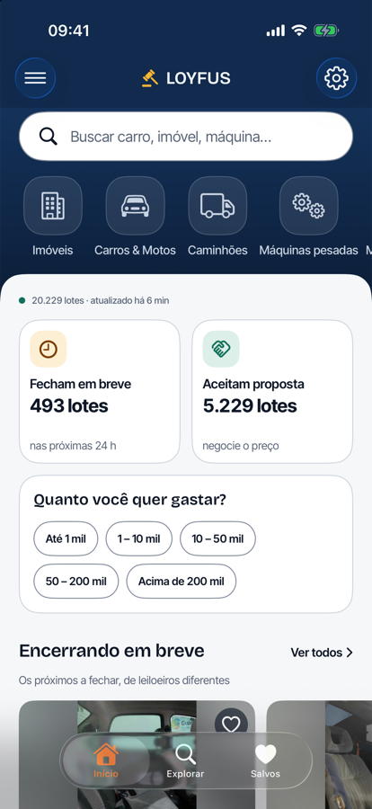
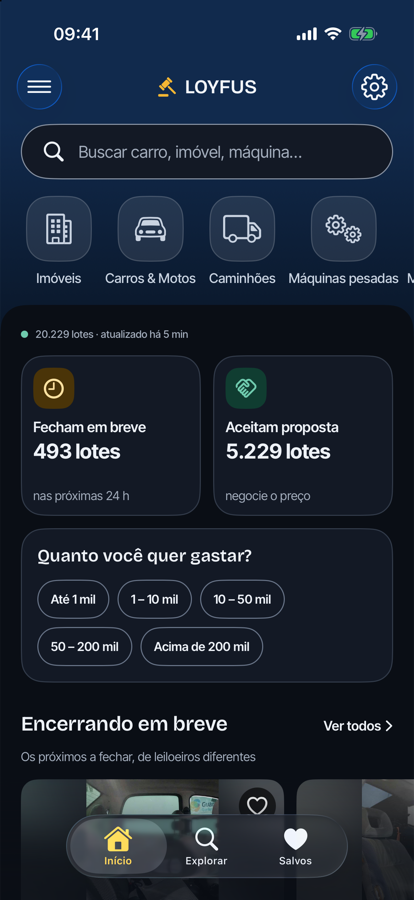

<p align="center">
  
</p>

<h1 align="center">Loyfus · iOS</h1>

<p align="center">
  <b>Catálogo de leilões brasileiros com dados reais.</b><br>
  <sub>SwiftUI · iOS 17+ · zero dependências externas</sub>
</p>

<p align="center">
  
  
  
</p>

---

## O app

Lote de leilão no Brasil tem um problema antigo: o preço está espalhado por dezenas de
portais, o título vem em CAIXA ALTA com código de anúncio no meio, e o prazo fica escondido.
O Loyfus junta isso num catálogo só — e cada lote guarda a **URL de origem**, então o arremate
sempre acontece no site do leiloeiro, nunca dentro do app.

**20.229 lotes**, **1.366 leilões**, **19 categorias** e **141.304 fotos** — coleta real,
verificada numa rodada completa contra a fonte pública.

<table>
  <tr>
    <td width="38%"><br><sub>Inicial — vitrines montadas no servidor</sub></td>
    <td width="38%"><br><sub>Tema escuro desenhado, não invertido</sub></td>
  </tr>
</table>

## O que ele faz

- **Inicial** — busca, atalhos de categoria e quatro vitrines montadas no servidor:
  *Encerrando em breve*, *Mais disputados*, *Acabaram de chegar* e *Imóveis*. Mostra há
  quanto tempo o catálogo foi atualizado.
- **Explorar** — busca com debounce, categorias, folha de filtros (tipo, prazo, faixa de
  preço, ordenação), tags removíveis e contagem ao vivo. O estado sobrevive à troca de aba.
- **Lote** — galeria com zoom, card de decisão com lance atual e prazo, resumo, ficha técnica,
  condições e edital. **Barra fixa com o botão que leva ao site do leiloeiro.**
- **Salvos** — favoritos anônimos por `device_id`, agrupados por urgência, com desfazer.

## Por que SwiftUI puro

O app **não tem dependência externa**. Nada de SPM, nada de CocoaPods — `project.yml`
descreve o target e o `Loyfus.xcodeproj` é gerado pelo
[XcodeGen](https://github.com/yonaskolb/XcodeGen). Isso significa que um `git clone` seguido de
`xcodegen generate` compila, sem resolver grafo de dependências e sem versão de ninguém para
conflitar.

O cliente HTTP, o cache de imagens e o parsing de JSON são ~200 linhas no total. Para um app
que fala com uma API que este próprio projeto publica, trazer um framework seria custo sem
contrapartida.

## Paridade com o Android

Formatação de preço em pt-BR, contagem regressiva e limpeza de título existem **espelhadas**
em Kotlin e em Swift. As duas implementações são testadas contra o mesmo golden de **1.566
títulos reais** de lote: cada string precisa voltar *exatamente* igual.

```swift
// LoyfusTests/LotTitleTests.swift
XCTAssertEqual(rows.count, 1_566, "the golden table is expected to hold 1,566 titles")
```

A comparação é escalar por escalar, porque o `==` do Swift trata strings canonicamente
equivalentes como iguais e esconderia uma diferença de composição. Foi por isso que os testes
foram escritos assim — e é o que transforma "os dois clientes devem bater" em algo que a
máquina verifica.

## Arquitetura

```
Loyfus/
├── Core/         formatação de preço, limpeza de título, tema — espelhado no Android
├── Data/         cliente HTTP, repositório e stores (favoritos, buscas recentes)
├── DesignSystem/ tokens, componentes e o glifo da marca
└── Features/     telas (inicial, explorar, lote, salvos, ajustes)
```

`DesignSystem/` não guarda tela nenhuma: guarda token, botão, placa de foto e tile. É o que
permite a tela de lote e a de explorar compartilharem aparência sem compartilhar código de
negócio.

## Rodar

A base da API está em `AppConfig.apiBaseURL`. O simulador alcança a máquina em
`127.0.0.1:8080`; para um **dispositivo físico**, aponte para o IP do Mac na rede — `127.0.0.1`
lá é o próprio celular.

```bash
xcodegen generate
xcodebuild -project Loyfus.xcodeproj -scheme Loyfus \
  -sdk iphonesimulator -configuration Debug build CODE_SIGNING_ALLOWED=NO

xcrun simctl install booted build/Debug-iphonesimulator/Loyfus.app
xcrun simctl launch booted br.com.loyfus
```

`project.yml` é a fonte; o `.xcodeproj` é gerado e pode ser reconstruído a qualquer momento.

## Testes

```bash
xcodebuild test -project Loyfus.xcodeproj -scheme Loyfus \
  -destination 'platform=iOS Simulator,name=iPhone 17 Pro' CODE_SIGNING_ALLOWED=NO
```

**54 testes, 0 falhas.** Formatação (26), exibição de lote (22) e limpeza de título (6) — as
mesmas regras do app Android, para nenhum dos dois clientes divergir do outro.

## Deep link

`loyfus://lot/<id>` abre o lote e `loyfus://explore` abre a busca, declarado no `Info.plist`
com o mesmo contrato do Android.

## Stack

| | |
|---|---|
| Linguagem | Swift 6 · iOS 17+ |
| UI | SwiftUI (sem UIKit, sem dependências) |
| Persistência | `Codable` + `UserDefaults` / arquivos no container |
| Build | XcodeGen · sem SPM, sem CocoaPods |

---

Parte de um projeto de três repositórios: [`loyfus-backend`](https://github.com/loyfus/loyfus-backend)
(crawler + API + banco) e [`loyfus-android`](https://github.com/loyfus/loyfus-android)
(Kotlin + Compose). Nenhum cliente depende do código do outro — só do contrato HTTP.

<sub>Dados de coleção: SuperBid, via endpoints públicos consumidos pela própria vitrine do site.</sub>
